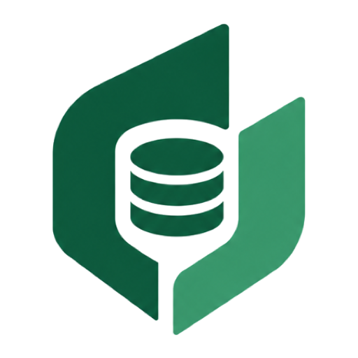

<p align="center">
  
</p>

<h1 align="center">QueryForge AI</h1>

<p align="center">
  <strong>Open-source, self-hosted AI Database Workspace & PostgreSQL Schema Explorer.</strong>
</p>

<p align="center">
  <a href="LICENSE"></a>
  <a href="https://nextjs.org/"></a>
  <a href="https://react.dev/"></a>
  <a href="https://www.typescriptlang.org/"></a>
  <a href="https://tailwindcss.com/"></a>
  <a href="https://fastapi.tiangolo.com/"></a>
  <a href="https://www.postgresql.org/"></a>
  <a href="https://ai.google.dev/"></a>
</p>

---

## ⚡ Overview

**QueryForge AI** is an open-source, developer-first AI Database Workspace designed for PostgreSQL. It allows developers and data teams to:
- Connect securely to local databases (Docker/localhost/LAN) or managed cloud databases (Neon, Supabase, AWS RDS, GCP Cloud SQL).
- Automatically introspect catalog metadata to generate interactive schema explorers and entity-relationship dependency graphs.
- Ask questions in natural language and receive safe, read-only SQL queries powered by **Google Gemini 2.0 Flash** with multi-pass AST query safety validation.

---

## 🚀 Key Features

* **🔌 Universal PostgreSQL Connector:**
  - One-click presets for **Local Dev** (Docker/localhost), **Cloud** (Neon, Supabase, RDS), and **Custom Intranet** environments.
  - Built-in diagnostic connection probe with latency calculation (`ms`) and SSL negotiation verification (`disable`, `prefer`, `require`, `verify-ca`, `verify-full`).

* **🛡️ SSRF & Network Guardrails:**
  - Strict destination host verification via system DNS resolution.
  - Automatically blocks dangerous cloud instance metadata endpoints (`169.254.169.254`) and unauthorized link-local IP subnets before any connection attempt.

* **🔐 Zero Plaintext Credential Exposure:**
  - Target database credentials are encrypted at rest using **Fernet (AES-128-CBC + HMAC-SHA256)** with key rotation support (`MultiFernet`).
  - Passwords and connection strings are strictly stripped and never serialized in API responses or frontend state.

* **📑 Automatic Schema Discovery:**
  - High-performance, async schema extraction introspecting tables, columns, data types, nullability, primary keys, and foreign keys directly from `pg_catalog`.
  - Live table and column search with instantaneous filtering.

* **📊 Interactive Schema Explorer:**
  - Dedicated project workspace providing table detail inspectors, estimated row counts, and column constraint badges.
  - Context toggles: exclude internal or sensitive tables from AI query generation prompts.

* **🤖 Safe AI Query Generation (Gemini 2.0 Flash):**
  - Natural-language to SQL translation using Google's latest Gemini 2.0 Flash model.
  - Multi-pass SQL validation powered by `sqlglot` AST parsing, enforcing strict read-only execution boundaries and statement timeouts.

* **🎨 Sleek, Developer-Centric UI:**
  - Studio theme supporting both clean neutral dark and light modes.
  - Dynamic micro-animations, real-time toast feedback with Sonner, and responsive layouts.

---

## 🏗️ Architecture & Tech Stack

```
queryforge/
├── apps/
│   ├── web/                     # Next.js 16 (App Router) Frontend
│   │   ├── src/app/             # Pages, route handlers, layouts
│   │   ├── src/components/      # Reusable UI components & Schema Explorer
│   │   ├── src/domain/          # Business logic, Zustand stores & validation
│   │   └── src/infrastructure/  # Type-safe API client & HTTP repositories
│   └── api/                     # FastAPI (Python 3.12+) Backend
│       ├── app/core/            # Config, security vault, database setup
│       ├── app/routers/         # Versioned REST API endpoints (/api/v1)
│       ├── app/schemas/         # Pydantic v2 validation models
│       ├── app/services/        # Connection pool, schema extractor, network guard
│       └── tests/               # Pytest integration & unit test suite
├── docs/                        # Architectural specifications & system design
├── LICENSE                      # Apache 2.0 License
└── README.md                    # Project overview & quickstart
```

### Technology Breakdown

| Component | Technology | Description |
| :--- | :--- | :--- |
| **Frontend Framework** | **Next.js 16** (App Router, React 19) | Server and Client components with optimized routing. |
| **Language** | **TypeScript 5** (Strict) | End-to-end type safety across domain models and HTTP clients. |
| **Styling** | **Tailwind CSS 4** | Clean, responsive design tokens with full Dark/Light theme support. |
| **State Management** | **Zustand** | Lightweight, reactive domain stores for connections and schema state. |
| **Icons & Feedback** | **Lucide React** & **Sonner** | Modern icon set and non-blocking toast notifications. |
| **Backend API** | **FastAPI** (Python 3.12+) | High-performance asynchronous REST API. |
| **Database ORM** | **SQLAlchemy 2.0 (async)** + **asyncpg** | Non-blocking database access and target connection pooling. |
| **Migrations** | **Alembic** | Automated database schema versioning and migrations. |
| **SQL AST Parsing** | **sqlglot** | PostgreSQL dialect query analysis and read-only enforcement. |
| **Cryptography** | **cryptography** (Fernet) | Symmetric AES-128 credential encryption at rest. |
| **AI LLM Engine** | **Google Gemini 2.0 Flash** | Natural-language query synthesis via `google-genai` SDK. |

---

## 🚦 Getting Started

### Prerequisites

Ensure you have the following installed on your machine:
- **Node.js** 20.x or higher and **npm**
- **Python** 3.12 or higher
- **PostgreSQL** (running locally or in Docker)
- [uv](https://docs.astral.sh/uv/) (recommended for fast Python package management) or `pip`

---

### 1. Setup Backend (`apps/api`)

1. Open a terminal and navigate to the backend directory:
   ```bash
   cd apps/api
   ```

2. Copy the environment configuration template:
   ```bash
   cp .env.example .env
   ```
   *(Update `DATABASE_URL` in `.env` to point to your PostgreSQL instance, and optionally add your `GEMINI_API_KEY`).*

3. Install Python dependencies:
   ```bash
   # Using uv (fastest)
   uv sync --extra dev

   # Or using standard pip
   pip install -r requirements.txt
   ```

4. Run database migrations:
   ```bash
   uv run alembic upgrade head
   ```

5. Start the backend development server:
   ```bash
   make dev
   # Or: uv run uvicorn app.main:app --reload --host 0.0.0.0 --port 8000
   ```
   The API will be available at [http://localhost:8000](http://localhost:8000), with interactive Swagger documentation at [http://localhost:8000/docs](http://localhost:8000/docs).

---

### 2. Setup Frontend (`apps/web`)

1. Open a separate terminal and navigate to the web directory:
   ```bash
   cd apps/web
   ```

2. Copy the environment configuration:
   ```bash
   cp .env.example .env.local
   ```
   *(Defaults to `NEXT_PUBLIC_API_URL=http://localhost:8000`).*

3. Install frontend dependencies:
   ```bash
   npm install
   ```

4. Start the Next.js development server:
   ```bash
   npm run dev
   ```

5. Open [http://localhost:3000](http://localhost:3000) in your browser.

---

## 🔒 Security & Privacy by Design

QueryForge AI is engineered around strict defense-in-depth security principles:

1. **Read-Only Invariant:** Customer database connections execute under strict connection-level read-only constraints (`default_transaction_read_only = on`) with rigorous statement timeouts.
2. **SSRF Guard:** An active network guard inspects every target host before connection initialization, blocking private cloud instance metadata (AWS EC2, GCP, Azure, DigitalOcean) and preventing intranet port scanning.
3. **Encrypted at Rest:** Database passwords are encrypted with individual Fernet keys and never stored in plain text or logged.
4. **Self-Hosted Privacy:** All database credentials, schemas, and queries stay on your infrastructure. Data never leaves your network unless explicitly forwarded to the AI provider.

---

## 🧪 Testing

### Backend Unit & Integration Tests
```bash
cd apps/api
uv run pytest
```

### Frontend Typecheck & Linting
```bash
cd apps/web
npx tsc --noEmit
npm run lint
```

---

## 📄 License

QueryForge AI is open-source software licensed under the [Apache License, Version 2.0](LICENSE).
