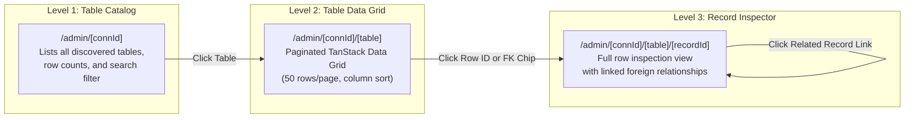
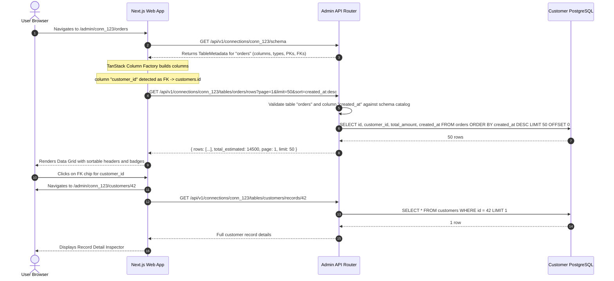

# Schema-Driven Generated Admin Architecture

## 1. Objective & Scope

This document specifies the architecture for the **Schema-Driven Auto-Generated Admin Interface**. The admin panel provides users with a complete web interface to browse database tables, search and sort records, inspect individual rows, and navigate relational foreign keys **without writing any frontend code**. 

Crucially, this system is **deterministic and schema-driven**: it uses pre-compiled, audited React components dynamically configured by schema metadata. It strictly forbids arbitrary AI code generation or client-side runtime script evaluation.

---

## 2. Main Components & Responsibilities

```mermaid
graph TD
    subgraph Frontend["Next.js Frontend (apps/web)"]
        Router["Dynamic Next.js App Router<br/>- /admin/[connId]<br/>- /admin/[connId]/[table]<br/>- /admin/[connId]/[table]/[recordId]"]
        SchemaLoader["Schema Metadata Consumer<br/>- Reads cached table/column metadata"]
        ColumnFactory["TanStack Column Factory<br/>- Maps SQL types to Cell Renderers<br/>- Attaches FK Navigation Chips"]
        DataGrid["TanStack Table v8 Data Grid<br/>- Sorting, Pagination, Search"]
        RecordView["Record Detail Inspector<br/>- Displays row fields & linked records"]
    end

    subgraph BackendAPI["Backend API (apps/api)"]
        AdminRouter["Admin Data API Router"]
        QueryBuilder["Safe Admin Query Builder<br/>- Parameterized SELECT LIMIT/OFFSET<br/>- sqlglot SQL AST Verification"]
        Executor["Read-Only Query Executor (asyncpg)"]
    end

    subgraph CustomerDB["Customer PostgreSQL"]
        DBRows[("Customer Database Tables")]
    end

    Router --> SchemaLoader
    SchemaLoader --> ColumnFactory
    ColumnFactory --> DataGrid
    Router --> RecordView

    DataGrid -->|GET /admin/tables/{table}/rows?page=1&limit=50| AdminRouter
    RecordView -->|GET /admin/tables/{table}/records/{id}| AdminRouter

    AdminRouter --> QueryBuilder
    QueryBuilder --> Executor
    Executor -->|Execute Read-Only Query| DBRows
```

| Component | Responsibility |
| :--- | :--- |
| **Dynamic App Router** | Next.js App Router dynamic routes providing navigation across connections, tables, and specific records. |
| **Schema Metadata Consumer** | Loads cached schema graph from the backend; extracts column definitions, primary keys, and foreign-key relationships. Excludes tables marked hidden. |
| **TanStack Column Factory** | Dynamically synthesizes TanStack Table v8 column configurations based on PostgreSQL data types (timestamps, booleans, numeric, uuid, text, jsonb). |
| **Relational Linker** | Identifies foreign-key columns (`column.is_foreign_key === true`) and renders clickable navigation chips leading directly to the target record (`/admin/[connId]/[targetTable]/[targetId]`). |
| **Safe Admin Query Builder** | Generates strict, parameterized SQL queries for table browsing (`SELECT {columns} FROM {table} ORDER BY {sort} LIMIT :limit OFFSET :offset`). Validates all identifiers against schema metadata to prevent SQL injection. |
| **Record Detail Inspector** | Renders a detailed two-column inspector for an individual row, highlighting primary keys, formatting JSON objects, and querying directly linked child records. |

---

## 3. Dynamic Route Hierarchy & Navigation Flow

The admin interface organizes data access into three progressive levels:



---

## 4. Primary Data Flow: Table Browsing & Foreign Key Traversal



---

## 5. Cell Rendering Matrix by PostgreSQL Data Type

The frontend maps PostgreSQL catalog data types to purpose-built, accessible UI renderers:

| PostgreSQL Type | UI Component Renderer | Interactive Behavior |
| :--- | :--- | :--- |
| **Primary Key (Any)** | High-contrast badge with key icon | Clickable link navigating to `/admin/[connId]/[table]/[id]`. |
| **Foreign Key (Any)** | Blue navigation pill with arrow icon | Clickable link navigating to `/admin/[connId]/[targetTable]/[targetId]`. |
| **`timestamp`, `timestamptz`** | Formatted local date/time (`MMM dd, yyyy HH:mm`) | Tooltip showing full UTC ISO 8601 string. |
| **`boolean`** | Status chip (Green `true`, Gray `false`) | High-visibility boolean indicator. |
| **`numeric`, `decimal`, `float`, `int`** | Monospaced right-aligned text | Numeric formatting with comma separators. |
| **`json`, `jsonb`** | Collapsible JSON tree viewer or truncate badge | Click to expand modal with formatted JSON payload. |
| **`text`, `varchar`** | Truncated string with text overflow ellipsis | Hover tooltip displaying full text if > 50 characters. |
| **`null`** | Subdued italic `NULL` label | Distinguishes empty string `""` from SQL `NULL`. |

---

## 6. Security & Performance Invariants

### 6.1 Zero Code Generation Safety
- **No Client Code Evaluation:** Unlike AI tools that generate raw React code or execute LLM scripts in the browser, QueryForge AI uses **100% static, pre-compiled UI components**.
- The schema metadata serves solely as *data* driving declarative props into existing audited components (`<DataTable />`, `<RecordInspector />`).

### 6.2 SQL Injection Prevention on Dynamic Admin Queries
- When users sort by a column or filter rows, the backend **never concatenates raw user strings** into SQL statements.
- **Identifier Whitelisting:** The backend verifies that the requested `table_name` and `sort_column` exist in the cached schema graph before generating the query.
- Filter values are passed exclusively as parameterized bind variables (`:param_1`).

### 6.3 Bounded Memory & Server Pagination
- Browsing tables containing millions of rows is kept performant via strict server-side pagination (`LIMIT 50 OFFSET X`).
- Total row counts are retrieved from PostgreSQL catalog estimates (`pg_class.reltuples`) rather than expensive `COUNT(*)` queries to prevent table locks.

---

## 7. Assumptions, Unresolved Decisions & Research Areas

### 7.1 Assumptions
- Tables possess an explicit Primary Key (single column or composite) to enable reliable record-level inspection.
- The schema cache accurately reflects table column names and relations.

### 7.2 Unresolved Decisions
1. **Tables Without Primary Keys:** How should the admin panel handle heap tables lacking a primary key? *(Default: Allow table grid browsing with pagination, but disable individual record inspector navigation).*
2. **Composite Primary Keys:** How should compound primary keys (`order_id`, `item_id`) be formatted in dynamic route URLs? *(Default: URL-encoded JSON or dash-separated tuple `/admin/[connId]/[table]/order_id:101,item_id:2`).*
3. **Column Reordering & Visibility:** Should users be able to persist custom column ordering and hidden column preferences per table? *(Default for MVP: Stored in browser `localStorage`; persistent user UI preferences deferred to Phase 4).*

### 7.3 Areas for Further Research
- **Virtual Scrolling vs. Paginated Grid:** Evaluating TanStack Virtual for seamless infinite-scroll browsing on wide schemas with 50+ columns.
- **Dynamic Full-Text Search:** Exploring PostgreSQL `websearch_to_tsquery` integration for lightning-fast search across text columns without table scans.
