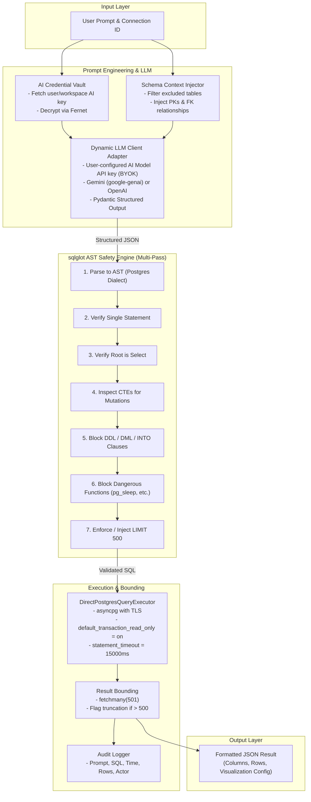
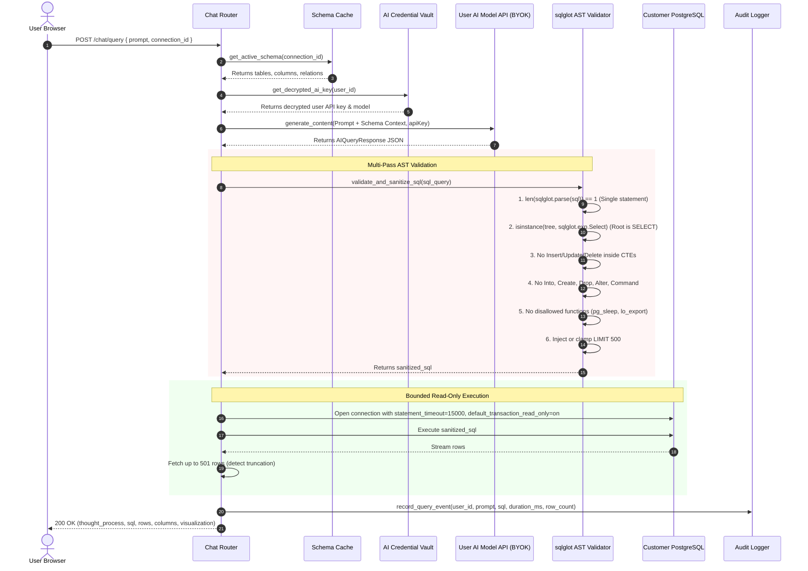

# AI Query Pipeline & SQL Safety Architecture

## 1. Objective & Scope

This document specifies the architecture for translating natural-language questions into safe, deterministic, bounded PostgreSQL queries and visualization configurations. It covers prompt engineering with schema context, user-configured AI model integration (Bring-Your-Own-Key / BYOK), multi-pass Abstract Syntax Tree (AST) safety validation using `sqlglot`, and read-only query execution.

---

## 2. Main Components & Responsibilities



| Component | Responsibility |
| :--- | :--- |
| **Schema Context Injector** | Formats database schema metadata (tables, columns, data types, primary keys, foreign keys) into a concise prompt context. Respects user table exclusion settings to preserve token budgets and privacy. |
| **AI Credential Vault** | Securely decrypts the user's stored AI model API key at runtime using Fernet symmetric encryption. |
| **Dynamic LLM Client Adapter** | Dynamically instantiates the LLM client using the user's configured provider API key and model (e.g., Google Gemini via `google-genai` SDK or OpenAI-compatible endpoint). Enforces structured JSON output (`response_schema=AIQueryResponse`) to cleanly separate thought reasoning, SQL, and visualization configuration. |
| **`sqlglot` Multi-Pass AST Validator** | Parses the raw SQL string into an Abstract Syntax Tree. Enforces 6 strict validation passes to guarantee that queries are exclusively read-only and non-destructive before reaching the database. |
| **Query Executor (`DirectPostgresQueryExecutor`)** | Executes validated queries against the customer database within a `BEGIN TRANSACTION READ ONLY` block with a 15-second statement timeout. |
| **Result Bounding Engine** | Fetches at most 501 rows (`fetchmany(501)`). If 501 rows are returned, the result is capped at 500 and marked as truncated to protect memory. |
| **Audit Logger** | Records the connection ID, prompt text, generated SQL, execution duration, and row counts in the internal application database. |

---

## 3. Detailed Data Flow & Validation Sequence



---

## 4. Structured AI Output Contract

The interaction with Gemini enforces a strict Pydantic JSON schema:

```json
{
  "thought_process": "To find top 5 customers by revenue, join customers with orders, group by customer name, sum total_amount, order descending, limit 5.",
  "sql_query": "SELECT c.id, c.name, SUM(o.total_amount) AS total_revenue FROM customers c JOIN orders o ON c.id = o.customer_id GROUP BY c.id, c.name ORDER BY total_revenue DESC LIMIT 5;",
  "visualization": {
    "chart_type": "bar_chart",
    "title": "Top 5 Customers by Revenue",
    "x_axis_column": "name",
    "y_axis_columns": ["total_revenue"],
    "metric_label": null,
    "description": "Comparison of customer revenue"
  }
}
```

Supported visualization types:
- `table`: Standard tabular display.
- `bar_chart`: Categorical aggregations and comparisons.
- `line_chart`: Time-series trends and chronological metrics.
- `pie_chart`: Proportion and distribution breakdowns.
- `metric_card`: Single scalar values (e.g., total count, total revenue).

---

## 5. Security & Safety Rules

### 5.1 Multi-Pass AST Safety Invariants
1. **Single Statement Invariant:** Disallows semicolons that chain multiple statements (`SELECT 1; DROP TABLE users;`).
2. **Root Select Invariant:** The root expression of the AST must evaluate to `sqlglot.exp.Select`.
3. **Common Table Expression (CTE) Inspection:** PostgreSQL allows mutations inside CTEs (e.g., `WITH deleted AS (DELETE FROM orders RETURNING *) SELECT * FROM deleted;`). The validator walks all `With` nodes and forbids any `Insert`, `Update`, `Delete`, or `Merge` expressions.
4. **Clause Blacklist:** Blocks `SELECT ... INTO` (which creates tables), `COPY` (file system operations), and all transaction control statements (`COMMIT`, `ROLLBACK`).
5. **Function Blacklist:** Explicitly forbids dangerous PostgreSQL functions:
   - Time-delay / DoS: `pg_sleep`, `pg_sleep_for`, `pg_sleep_until`
   - File system access: `lo_export`, `lo_import`, `pg_read_file`, `pg_write_file`
   - Backend termination: `pg_terminate_backend`, `pg_cancel_backend`
   - System state modification: `set_config`
6. **Automatic LIMIT Clamping:** If the query lacks a `LIMIT` clause, `LIMIT 500` is automatically appended. If the query specifies `LIMIT > 500`, it is rewritten to `LIMIT 500`.

### 5.2 Native Database-Level Safeguards
- **Read-Only Session Mode:** Connections are opened with `default_transaction_read_only = on`. Any query attempting mutations is halted by PostgreSQL itself.
- **Statement Timeout:** Every query is executed under `SET statement_timeout = 15000;`. Any runaway Cartesian join or full table scan is terminated after 15 seconds with a graceful error.

---

## 6. Assumptions, Unresolved Decisions & Research Areas

### 6.1 Assumptions
- The LLM can generate valid PostgreSQL syntax when given accurate schema context.
- Single-statement `SELECT` queries are sufficient for all read-only analytics in MVP.

### 6.2 Unresolved Decisions
1. **Self-Correction Retry Loop:** If `sqlglot` rejects a query or PostgreSQL returns a syntax error, should the backend automatically re-prompt the LLM once with the error message for self-correction? *(Default: Return a clear error to the user in MVP; add single retry loop in Phase 2).*
2. **Query Result Caching:** Should identical natural-language questions reuse cached query results within a short time window (e.g., 60 seconds)? *(Default: No caching in MVP to ensure real-time query accuracy).*
3. **Rate Limiting:** How should prompt requests be throttled to prevent accidental token overconsumption? *(Default: Configurable local rate limit of 60 requests/minute).*

### 6.3 Areas for Further Research
- **Dynamic Few-Shot Prompting:** Dynamically selecting 2–3 relevant sample SQL queries based on user prompt embeddings to improve accuracy on complex schema queries.
- **Handling Schema Token Limits:** For enterprise databases with 500+ tables, developing a two-stage retrieval pipeline (Schema Retrieval Agent) to identify relevant tables before generating SQL.
