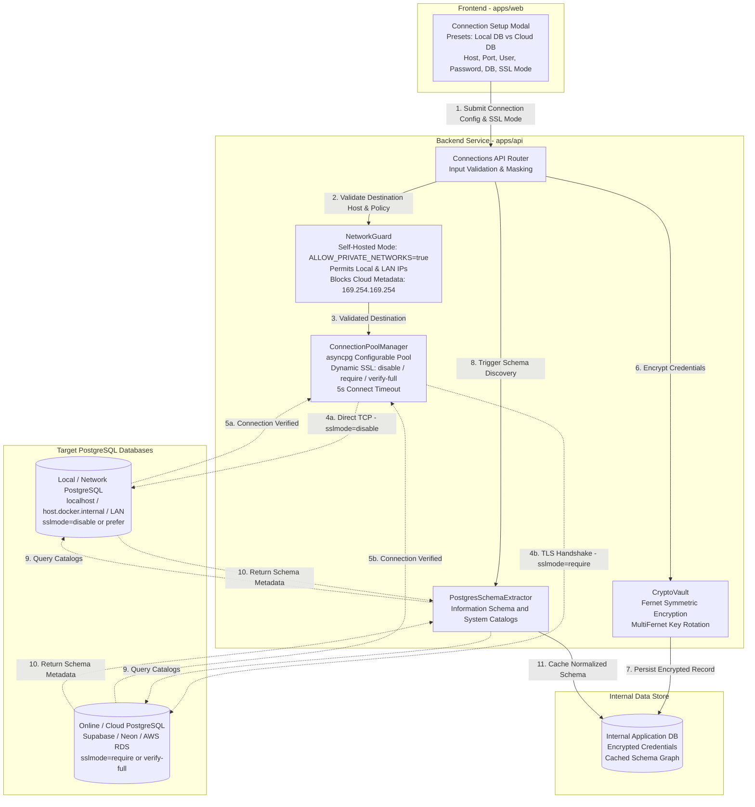
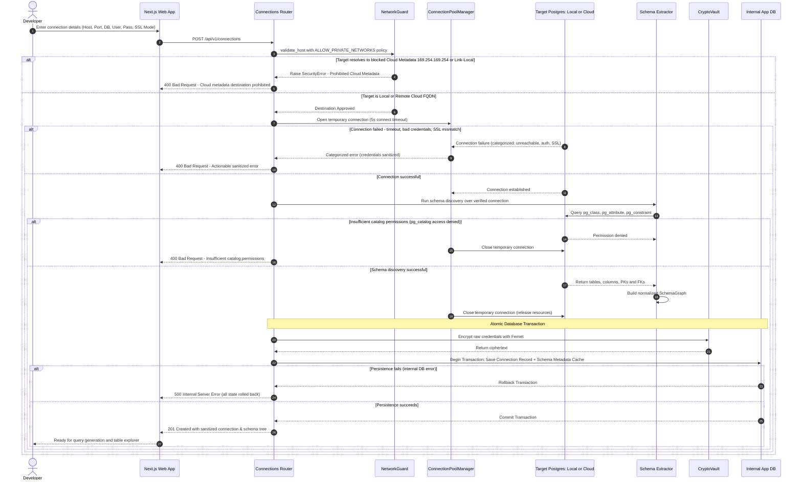

# Database Connections & Schema Discovery Architecture (Local & Remote)

## 1. Objective & Scope

This document specifies the architecture for onboarding, validating, encrypting, maintaining, and introspecting PostgreSQL databases within **QueryForge AI**.

Following QueryForge AI's self-hosted, downloadable developer model, the application is designed to run locally on the developer's workstation or within a local network (e.g., via native dev servers or `docker compose`). Under this paradigm, QueryForge AI supports connecting to two primary classes of PostgreSQL databases:

1. **Local & Private Network Databases:**
   - Databases running directly on `localhost`, `127.0.0.1`, or `::1`.
   - Databases running inside Docker containers or on the host machine via `host.docker.internal` / container network aliases.
   - Databases hosted on the local area network (LAN / intranet) such as home labs, office development servers, or private subnets (`192.168.0.0/16`, `10.0.0.0/8`, `172.16.0.0/12`).
   - Standard connectivity: Plaintext TCP (`sslmode=disable` or `prefer`) or self-signed TLS. Direct socket connectivity without requiring external reverse-tunnel agents.

2. **Online & Cloud-Hosted Databases:**
   - Managed cloud PostgreSQL instances (e.g., Supabase, Neon, AWS RDS, GCP Cloud SQL, Azure Database for PostgreSQL, Railway, Aiven).
   - Standard connectivity: TLS-encrypted connections (`sslmode=require`, `verify-ca`, or `verify-full`) over the public internet or cloud VPCs.

This document details the updated network validation layer, configurable SSL/TLS negotiation, credential encryption at rest, connection pooling safeguards, and the schema discovery engine.

---

## 2. Main Components & Responsibilities



| Component | Responsibility |
| :--- | :--- |
| **Connections API Router (`/api/v1/connections`)** | Located in `app/routers/v1/connections.py`. Receives connection parameters, validates input format via Pydantic, orchestrates testing and persistence, and guarantees secrets/passwords are never returned in response models. |
| **NetworkGuard (Self-Hosted Guard)** | Resolves hostnames against DNS. In self-hosted mode (`ALLOW_PRIVATE_NETWORKS=true`), explicitly permits `localhost`, `127.0.0.1`, `host.docker.internal`, and private LAN subnets (`192.168.0.0/16`, `10.0.0.0/8`, `172.16.0.0/12`), while strictly blocking hazardous cloud instance metadata addresses (`169.254.169.254`). |
| **CryptoVault (Fernet)** | Manages symmetric encryption and decryption of sensitive database credentials using Fernet (AES-128-CBC + HMAC-SHA256). Supports key rotation via `MultiFernet`. |
| **ConnectionPoolManager** | Configures and caches `asyncpg` connection pools. Dynamically applies the appropriate SSL context (`disable`, `prefer`, `require`, `verify-ca`, `verify-full`), enforces a strict 5-second connect timeout, and sets statement timeouts. |
| **PostgresSchemaExtractor** | Queries PostgreSQL system catalogs (`pg_class`, `pg_attribute`, `pg_constraint`, `pg_type`, `pg_namespace`) to construct a relational schema graph. |
| **Schema Cache Repository** | Persists discovered schema metadata in the internal application database and manages user table/column inclusion and exclusion flags. |

---

## 3. Connection Verification & Schema Discovery Sequence

The diagram below details the end-to-end flow when a developer connects either a local database on their machine/network or an online cloud database.



---

## 4. Primary Data Flows & Lifecycle States

### 4.1 Connection Configuration Model

The incoming connection request model supports both local and remote database targets:

```python
from enum import Enum
from typing import Optional
from pydantic import BaseModel, Field

class SSLMode(str, Enum):
    DISABLE = "disable"      # Plaintext TCP (Standard for localhost / Docker dev)
    PREFER = "prefer"        # Try SSL first, fallback to plaintext if unsupported
    REQUIRE = "require"      # Enforce SSL/TLS (Standard for Supabase, Neon, AWS RDS)
    VERIFY_CA = "verify-ca"  # Enforce SSL and verify CA certificate chain
    VERIFY_FULL = "verify-full" # Enforce SSL, verify CA chain and hostname match

class ConnectionCreateRequest(BaseModel):
    name: str = Field(..., example="Local Dev DB")
    host: str = Field(..., example="localhost")  # or "host.docker.internal", "192.168.1.50", "ep-xxx.neon.tech"
    port: int = Field(default=5432, ge=1, le=65535)
    database: str = Field(..., example="myapp_dev")
    username: str = Field(..., example="postgres")
    password: str = Field(..., example="secret")
    ssl_mode: SSLMode = Field(default=SSLMode.DISABLE)
    custom_ca_cert: Optional[str] = Field(default=None, description="Optional PEM CA certificate for custom/self-signed roots")

class ConnectionResponse(BaseModel):
    id: str
    name: str
    host: str
    port: int
    database: str
    username: str
    ssl_mode: SSLMode
    status: str
    created_at: str
    # Note: Password is NEVER serialized or returned in the response
```

### 4.2 Connection Lifecycle States

1. **PENDING_VERIFICATION:** Connection config submitted; awaiting network safety checks, host reachability, and credential handshake.
2. **ACTIVE:** Credentials verified, encrypted at rest via Fernet, and schema metadata successfully cached.
3. **INTROSPECTION_FAILED:** Connection verified successfully, but system catalog queries failed (e.g., user account lacks `SELECT` on `pg_catalog` or `information_schema`).
4. **UNREACHABLE / ERROR:** Connection failed due to wrong password, offline database, closed network port, or TLS handshake mismatch.
5. **DISABLED:** Manually paused or disabled by the user.

### 4.3 Schema Metadata Normalization Contract

Schema discovery extracts the database structure into a normalized, client-friendly structure:

```json
{
  "connection_id": "3fa85f64-5717-4562-b3fc-2c963f66afa6",
  "database_name": "myapp_dev",
  "introspected_at": "2026-10-15T19:30:00Z",
  "tables": [
    {
      "name": "orders",
      "schema": "public",
      "estimated_row_count": 14500,
      "is_excluded": false,
      "columns": [
        {
          "name": "id",
          "data_type": "integer",
          "nullable": false,
          "is_primary_key": true,
          "is_foreign_key": false
        },
        {
          "name": "customer_id",
          "data_type": "integer",
          "nullable": false,
          "is_primary_key": false,
          "is_foreign_key": true
        },
        {
          "name": "total_amount",
          "data_type": "numeric(10,2)",
          "nullable": false,
          "is_primary_key": false,
          "is_foreign_key": false
        }
      ],
      "foreign_keys": [
        {
          "column": "customer_id",
          "target_table": "customers",
          "target_column": "id"
        }
      ]
    }
  ]
}
```

---

## 5. Security & Reliability Considerations

### 5.1 Network Security in a Self-Hosted / Local-First Environment

In a self-hosted developer tool, the security posture differs fundamentally from a public multi-tenant SaaS:

1. **Permitting Local & Private Networks (`ALLOW_PRIVATE_NETWORKS=true`):**
   - By default in QueryForge AI, developers must be able to connect to databases running on their own machine or local office/homelab network.
   - The NetworkGuard explicitly permits:
     - Loopback addresses (`127.0.0.1`, `localhost`, `::1`).
     - Docker internal gateways (`host.docker.internal`).
     - RFC 1918 private subnets (`10.0.0.0/8`, `172.16.0.0/12`, `192.168.0.0/16`).
     - Docker bridge and container network names.

2. **Hardened Cloud Instance Metadata Defense:**
   - Even in self-hosted environments, developers may run QueryForge AI inside a cloud VM (e.g., AWS EC2, GCP Compute Engine, Azure VM, or DigitalOcean Droplet).
   - To prevent accidental Server-Side Request Forgery (SSRF) against cloud provider metadata services (which could expose temporary IAM credentials or service account tokens), the NetworkGuard **always blocks**:
     - `169.254.169.254` (Cloud Instance Metadata Service endpoint).
     - IPv6 link-local metadata endpoints (`fe80::...`).
     - Any custom prohibited IPs designated in configuration.

3. **Docker Networking Resolution & Developer Guidance:**
   - When QueryForge AI runs inside a Docker container (e.g. `docker compose`), `localhost` inside the container refers to the container itself, not the developer's host machine.
   - The UI and NetworkGuard provide actionable guidance:
     - **Host Machine PostgreSQL (macOS & Windows Docker Desktop):** Use `host.docker.internal` instead of `localhost`.
     - **Host Machine PostgreSQL (Linux):** Use the host gateway IP or run with `--network host` / host-gateway mapping.
     - **Docker Container Database:** Use the container name or compose service name (e.g., `postgres-db:5432`) on the shared Docker bridge network.
     - **Network / LAN Database:** Use the local static/DHCP IP address (e.g., `192.168.1.150:5432`).

### 5.2 Flexible SSL / TLS Configuration

Local development setups and production cloud databases have very different TLS requirements:

1. **Local Connections (`sslmode=disable` or `prefer`):**
   - Most local PostgreSQL instances (installed via Homebrew, Apt, or basic Docker images) do not have TLS certificates configured.
   - The connection pool manager creates unencrypted TCP streams when `ssl_mode=disable`, avoiding SSL handshake errors (`SSL SYSCALL error: EOF detected`).
2. **Online Cloud Connections (`sslmode=require`, `verify-ca`, `verify-full`):**
   - Managed cloud providers (Neon, Supabase, RDS) mandate TLS.
   - The connection pool manager initializes Python's `ssl.create_default_context()` with standard root CAs to enforce encrypted in-transit data transmission over public networks.
3. **Custom CA Certificates:**
   - For enterprise intranets or local development using self-signed root certificates (e.g. `mkcert`), an optional `custom_ca_cert` PEM string can be provided to the connection configuration.

### 5.3 Credential Encryption & Key Management

- **Fernet Encryption:** Database passwords are encrypted before storage in the internal application database using symmetric Fernet encryption (AES-128-CBC + HMAC-SHA256).
- **Zero Credential Exposure:** Passwords are never serialized into API responses, never rendered into frontend markup, and never included in application logs or Sentry-style error telemetry.
- **Master Key Configuration:** The encryption key is sourced from `ENCRYPTION_MASTER_KEY` in `.env`. Key rotation across versions is supported via `MultiFernet`.

### 5.4 Connection Reliability, Timeouts & Pool Limits

- **Strict 5-Second Connection Timeout:** When testing connection reachability or establishing pools, connections time out after 5 seconds (`CUSTOMER_DB_CONNECT_TIMEOUT_SECONDS=5`). This prevents the application from hanging if a developer specifies an offline local LAN IP or a closed port.
- **Statement Timeout:** Every session executes under a 15-second statement timeout (`SET statement_timeout = 15000;`) to protect both local hardware and remote databases from accidental runaway scans.
- **Pool Sizing:** A maximum of 5 concurrent connections per target database pool in the MVP, preventing connection exhaustion on local developer machines or shared cloud databases.
- **Graceful Idle Cleanup:** Unused pools are closed and recycled after 5 minutes of inactivity.

---

## 6. Assumptions, Unresolved Decisions & Research Areas

### 6.1 Assumptions

- **Direct Network Accessibility:** In the self-hosted model, QueryForge AI and target databases share network reachability (e.g., same workstation, same local network, or direct internet access to cloud databases).
- **No Inbound Reverse Tunnel Needed:** Because QueryForge AI runs locally, an outbound reverse-tunnel agent (previously conceived for hosted SaaS in `03-feature-local-connector.md`) is **not required** for connecting to local databases.
- **User Permissions:** The provided database user credentials have `SELECT` permissions on target application tables and sufficient privileges to query PostgreSQL system catalogs (`pg_catalog`).
- **Read-Only Inspection:** Schema introspection is non-destructive and queries metadata only.

### 6.2 Unresolved Decisions

1. **Docker Environment Detection:** Can the backend automatically detect if it is running inside a Docker container and automatically suggest/rewrite `localhost` to `host.docker.internal` in the connection helper? *(MVP default: Provide a visual hint banner in the connection setup modal).*
2. **Zero-Config Embedded Internal Database:** Should single-developer local installations use SQLite for QueryForge's internal metadata state instead of requiring a dedicated internal PostgreSQL container? *(Evaluating SQLite for zero-config single-binary distribution).*
3. **Schema Cache Invalidation:** Automatic polling vs. manual refresh button. *(MVP default: Manual "Refresh Schema" button with timestamp display).*

### 6.3 Areas for Further Research

- **Multi-Database Federation:** Allowing developers to connect multiple local and remote databases simultaneously and cross-reference schemas.
- **Catalog Query Optimization for Large Schemas:** Benchmark introspection against large databases (1,000+ tables) and introduce schema filtering/pruning before sending context to the AI query generator.

---

## 7. Recommended MVP Connection Flow

1. **Preset Selection:** User opens the Connection Setup Modal and chooses between **"Local Database"** (pre-fills `host: localhost`, `port: 5432`, `ssl_mode: disable`) or **"Cloud Database"** (pre-fills `ssl_mode: require`).
2. **Payload Validation:** Validate input parameters with Pydantic. Ensure port is valid (1–65535) and all required fields are populated.
3. **NetworkGuard Verification:**
   - Resolve hostname via DNS/system resolver.
   - Verify destination is not pointing to restricted cloud metadata services (`169.254.169.254`) or link-local ranges.
   - Permit `localhost`, `host.docker.internal`, and LAN subnets.
4. **Target Reachability & SSL Handshake:**
   - Connect via `asyncpg` with a strict 5-second timeout.
   - Apply SSL configuration based on user's `ssl_mode` (`disable`, `prefer`, `require`, `verify-full`).
   - If connectivity or authentication fails, categorize into distinct, actionable errors (unreachable, authentication, SSL mismatch) and return immediately.
5. **Schema Introspection & Resource Cleanup:**
   - Query PostgreSQL system catalogs (`pg_class`, `pg_attribute`, `pg_constraint`, `pg_namespace`).
   - If system catalog access is denied, release connection and return distinct error: "Insufficient catalog permissions".
   - Construct normalized schema graph (tables, columns, primary keys, foreign keys).
   - Close temporary target connection immediately to prevent resource leakage.
6. **Atomic Database Transaction:**
   - Encrypt database password using Fernet symmetric encryption.
   - In a single internal database transaction, save the `DatabaseConnection` record (status: `ACTIVE`) and `SchemaCache` together.
   - If persistence fails, roll back completely.
7. **Client Response & Downstream Triggering:**
   - Return sanitized connection object (omitting passwords) and populated schema graph to the web client.
   - Only trigger AI query generation, chat sessions, or schema indexing after transaction commit succeeds.

---

## 8. Important Implementation Rules & Invariants

When implementing or modifying database connection workflows, the following invariants are strictly enforced:

1. **Do not save credentials before validation:**
   - Keep submitted credentials in request-scoped memory only.
   - Never persist, log, cache, or queue credentials prior to full host, network, authentication, and SSL handshake validation.

2. **Do not trigger background tasks early:**
   - AI query generation, chat session initialization, schema vector indexing, and dependent background workflows must wait until the connection and schema transaction has been committed successfully to the internal database.

3. **Use an atomic database transaction:**
   - Save the encrypted connection record and discovered schema metadata together in a single internal application database transaction.
   - If any step during internal persistence fails, the entire transaction is rolled back so no orphan connection or partial schema records exist.

4. **Separate connection validity from schema validity:**
   - Errors must be distinct, descriptive, and actionable:
     - **Incorrect credentials:** Inform user of failed authentication.
     - **Unreachable database / port timeout:** Inform user of network/host reachability or closed port.
     - **SSL/TLS handshake failure:** Inform user of SSL configuration mismatch and suggest appropriate SSL mode.
     - **Insufficient catalog permissions:** Inform user that the user account lacks `SELECT` privileges on `pg_catalog`.

5. **Close temporary resources:**
   - Release and close all temporary test connections and connection pools on both success and failure pathways (`try ... finally`).
   - Never leave hanging sockets or half-open connections to target databases.

6. **Keep error messages safe:**
   - Never return passwords, connection strings containing credentials, encryption keys, or unmasked driver stack traces to the frontend client.
   - Map low-level driver exceptions to sanitized, user-friendly messages.
