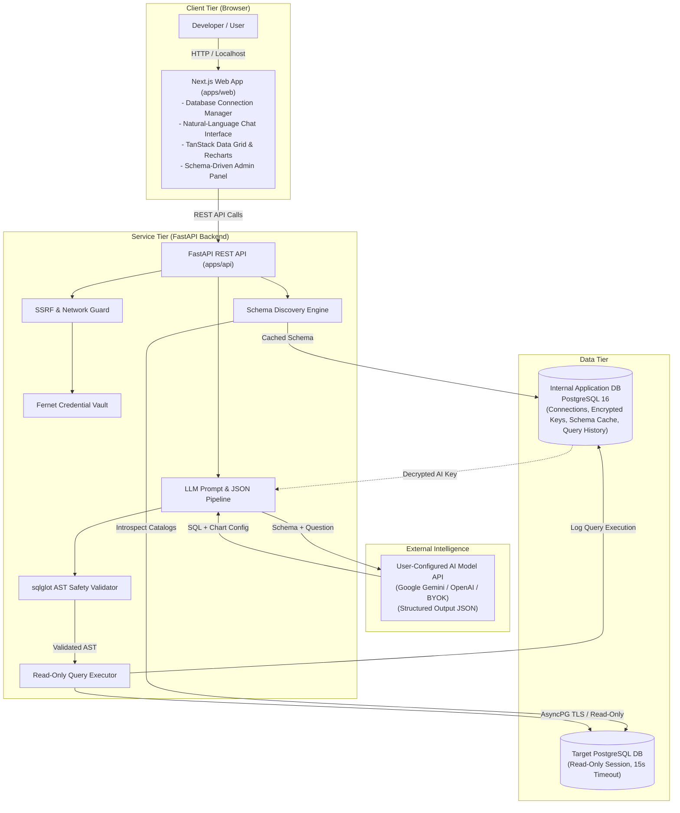
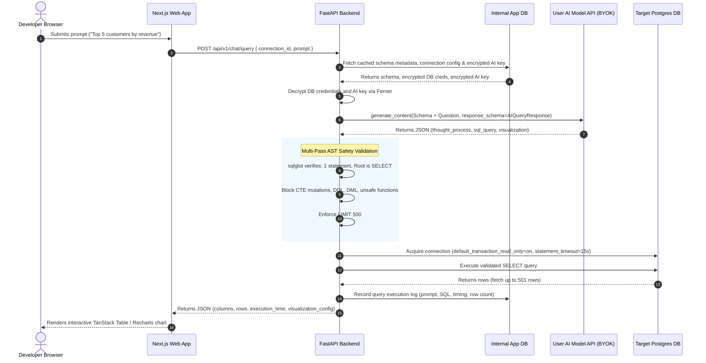

# System Architecture Overview

## 1. Objective & Scope

This document provides a high-level architectural overview of **QueryForge AI**. Designed as a developer-first, self-hosted open-source modular application, QueryForge AI allows developers to connect their PostgreSQL databases, perform natural-language queries with validated SQL execution, view dynamic visualizations, and explore an auto-generated admin panel without writing frontend code.

To prioritize developer simplicity and ease of local setup, the core architecture is **single-user / self-hosted by default**. Developers download or clone the repository, run the application, connect their databases directly, and work without the overhead of multi-tenant workspaces, user accounts, or complex permission trees.

---

## 2. High-Level Component Topology

QueryForge AI is structured into three clean, focused tiers:

1. **Frontend Web Application (`apps/web`):** Next.js App Router (React, TypeScript, Tailwind CSS, TanStack Table, Recharts) providing the database connection manager, natural-language chat console, data visualization, and schema-driven admin interface.
2. **Backend API (`apps/api`):** FastAPI (Python 3.12+, Pydantic v2) providing connection testing, credential encryption, SSRF protection, database schema introspection, LLM prompt assembly, `sqlglot` AST safety validation, and bounded query execution.
3. **Data Plane:**
   - **Internal Application Database:** Dedicated PostgreSQL instance (or local embedded store) that persists database connection profiles, cached schema metadata, and query history/audit logs. *Target database data rows are never stored here.*
   - **Target Database(s):** The developer's local or remote PostgreSQL database(s), accessed over direct network/TLS using read-only credentials with strict execution timeouts.

---

## 3. Main Components & Responsibilities

| Component | Technology | Core Responsibilities |
| :--- | :--- | :--- |
| **Frontend Web App** | Next.js 16, React 19, Tailwind CSS | - Connection manager UI to configure database host, port, credentials, and SSL. - AI Settings UI to configure user's AI model API key (BYOK) and preferred model. - Natural-language chat interface with thought reasoning and SQL inspection. - Deterministically renders data grids (TanStack Table) and interactive charts (Recharts). - Dynamically renders schema-driven admin pages (`/admin/[connId]/[table]`). |
| **Backend REST API** | FastAPI, Python 3.12+, Pydantic v2 | - Validates target hostnames and guards against SSRF. - Encrypts database credentials and user AI model API keys at rest using symmetric Fernet encryption. - Introspects target database schemas via PostgreSQL system catalogs. - Interfaces dynamically with user-configured AI model APIs (e.g. Gemini, OpenAI) using Pydantic structured output. - Enforces multi-pass SQL AST safety validation using `sqlglot`. - Executes queries within read-only transactions with 15-second statement timeouts. - Records query execution history in the application database. |
| **Internal Application DB** | PostgreSQL 16 | - Stores encrypted database connection configurations. - Stores encrypted user AI model API keys and preferred provider configuration. - Caches discovered table/column metadata and table inclusion/exclusion settings. - Stores prompt history, generated queries, and execution metrics. - **Guaranteed:** Never stores target database table records. |
| **Target Database(s)** | PostgreSQL (v12+) | - Local or remote databases being inspected and queried. - Queried strictly using read-only transaction semantics. |
| **AI Intelligence Provider (BYOK)** | User-Provided AI Model (Gemini / OpenAI) | - Generates accurate PostgreSQL `SELECT` queries from schema context and user prompts using the user's configured API key. - Suggests suitable visualization layouts (table, bar chart, line chart, pie chart, metric card). |

---

## 4. Primary End-to-End Data Flow

The sequence below illustrates the complete lifecycle of a natural language query in a developer workflow:

---

## 5. Security & Reliability Considerations

### 5.1 Defense-in-Depth SQL Safety
1. **Application-Level AST Validation:** `sqlglot` parses queries into abstract syntax trees. Statements are rejected if they contain DDL (`DROP`, `ALTER`, `CREATE`), DML (`INSERT`, `UPDATE`, `DELETE`), dangerous Postgres system functions (`pg_sleep`, `lo_export`), or multiple statements.
2. **Database-Level Read-Only Transactions:** Connections execute under `BEGIN TRANSACTION READ ONLY` with `server_settings={"default_transaction_read_only": "on"}`. Even if invalid SQL bypassed the AST parser, PostgreSQL natively rejects modifications.
3. **Strict Statement Timeouts:** Every connection enforces `statement_timeout = 15000` (15 seconds) to prevent runaway full-table scans or lockups on target databases.

### 5.2 Network & Credential Protection
1. **Configurable Network Guard:** In self-hosted development environments, developers can query local databases (e.g., Docker compose services, `localhost`) via `ALLOW_PRIVATE_NETWORKS=true`. When deployed remotely, SSRF guards can block private metadata ranges.
2. **At-Rest Encryption:** Connection strings are encrypted using Fernet (AES-128-CBC + HMAC-SHA256). Passwords are never serialized into API responses or logged.
3. **Data Plane Segregation:** Target database rows are streamed directly to the user's browser session and never persisted to the internal application database.

---

## 6. Assumptions, Unresolved Decisions & Research Areas

### 6.1 Assumptions
- **Developer Local-First:** Designed to be run locally by developers via `docker compose` or direct local dev servers (`npm run dev` and `uvicorn`).
- **PostgreSQL Focus:** MVP targets PostgreSQL instances (local Docker containers or hosted databases over TLS).
- **Read-Only Core:** MVP is strictly read-only; mutations are handled via explicit two-phase confirmation in Phase 2.

### 6.2 Unresolved Decisions
1. **Schema Invalidation:** Should schema discovery refresh automatically on a fixed polling schedule, or remain purely on-demand via a manual "Refresh Schema" button? *(Default: On-demand manual refresh).*
2. **Connection Pooling Strategy:** Should the backend maintain persistent connection pools per target database, or establish ephemeral pooled connections on demand with idle recycling? *(Default: Short-lived cached pools with 5-minute idle reap).*
3. **Internal Storage Option:** Should single-developer mode support a lightweight SQLite internal database alternative alongside PostgreSQL for zero-config setup? *(Researching for Phase 2).*

### 6.3 Areas for Further Research
- **Large Schema Context Optimization:** When a target database has 200+ tables, injecting the entire schema exceeds optimal LLM context windows. Researching lightweight vector embeddings or table-filtering heuristics for schema pruning.
- **Outbound Local Connector:** Evaluating WebSocket vs. gRPC reverse tunnels for the Phase 2 local agent connector to support private firewall traversal without opening inbound ports.
