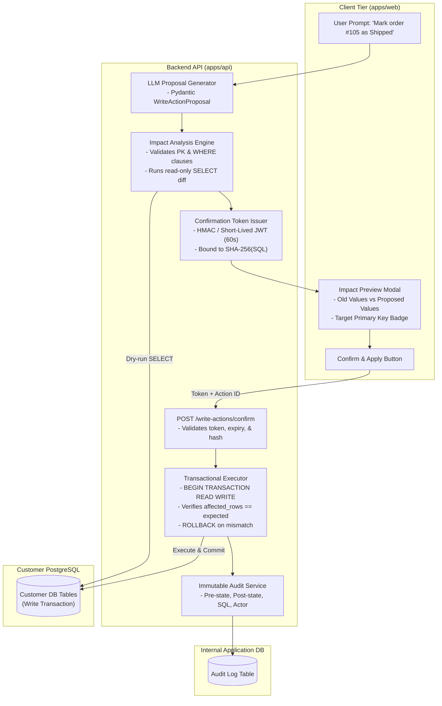

# Confirmed Write Operations Architecture (Phase 2)

## 1. Objective & Scope

This document specifies the architecture for **Confirmed Write Actions**, scheduled for implementation in Phase 2. While the MVP core is strictly read-only, this specification details the architectural foundation, security guardrails, and cryptographic lifecycle required to support targeted database mutations (updates, inserts, soft-deletes) safely and reliably.

---

## 2. Main Components & Responsibilities



| Component | Responsibility |
| :--- | :--- |
| **LLM Proposal Generator** | Prompts Gemini to return a structured `WriteActionProposal` (target table, mutation type, target primary key, old value, proposed new values). Forbids raw unparameterized SQL execution. |
| **Impact Analysis Engine** | Inspects the proposal, verifies target table and primary keys against schema metadata, and executes a read-only `SELECT` query to retrieve the current state of affected rows. |
| **Confirmation Token Issuer** | Issues a signed, tamper-proof confirmation token (60-second TTL) cryptographically bound to the canonical SQL hash, connection ID, and expected row count. |
| **Blast-Radius & WHERE Guard** | Enforces that all `UPDATE` and `DELETE` actions have explicit `WHERE` clauses targeting specific primary keys, and caps maximum affected rows to a strict threshold (e.g., 25 rows). |
| **Transactional Executor** | Opens an explicit read-write transaction (`BEGIN`), executes the parameterized statement, checks that `cursor.rowcount == expected_rows`, and commits or rolls back immediately. |
| **Immutable Audit Service** | Records the complete transaction trail in the internal application database: timestamp, actor ID, prompt, SQL statement, pre-state diff, and post-state diff. |

---

## 3. The 6-Step Safe Execution Lifecycle

Natural-language write requests must never execute directly or automatically. They must adhere to this deterministic lifecycle:

```mermaid
sequenceDiagram
    autonumber
    actor User as User Browser
    participant API as Backend Service
    participant Gemini as Gemini 2.0 Flash
    participant CustDB as Customer PostgreSQL
    participant IntDB as Internal App DB

    User->>API: 1. Prompt: "Change status of order #105 to Shipped"
    API->>Gemini: 2. Generate WriteActionProposal(table, mutation, pk, values)
    Gemini-->>API: Returns WriteActionProposal JSON

    rect rgb(240, 248, 255)
        Note over API,CustDB: Step 2: Impact Analysis & Dry Run
        API->>API: Validate table="orders", PK="id", WHERE clause present
        API->>CustDB: SELECT id, status FROM orders WHERE id = 105
        CustDB-->>API: Current Row: { id: 105, status: "Processing" }
        API->>API: Assert affected_rows == 1 (<= blast_radius 25)
    end

    rect rgb(255, 250, 240)
        Note over API,User: Step 3: Cryptographic Token & Preview
        API->>API: Build canonical SQL: "UPDATE orders SET status = 'Shipped' WHERE id = 105"
        API->>API: Generate ConfirmationToken(hash=SHA256(sql), rows=1, ttl=60s)
        API-->>User: Returns Preview Modal Data { diff: { old: "Processing", new: "Shipped" }, token }
    end

    User->>User: Reviews diff modal and clicks "Confirm & Apply Change"
    User->>API: 4. POST /write-actions/confirm { token }

    rect rgb(240, 255, 240)
        Note over API,CustDB: Step 5: Transactional Execution & Row Guard
        API->>API: Verify token signature, expiry (<60s), and sql_hash match
        API->>CustDB: BEGIN TRANSACTION READ WRITE
        API->>CustDB: UPDATE orders SET status = 'Shipped' WHERE id = 105
        CustDB-->>API: rowcount = 1
        alt rowcount != expected_rows
            API->>CustDB: ROLLBACK
            API-->>User: 500 Error ("Row count mismatch; transaction aborted")
        else rowcount == expected_rows
            API->>CustDB: COMMIT
        end
    end

    rect rgb(250, 240, 255)
        Note over API,IntDB: Step 6: Immutable Audit Log
        API->>IntDB: INSERT INTO audit_logs (user_id, prompt, sql, pre_diff, post_diff)
    end

    API-->>User: 200 OK { success: true, updated_row: { id: 105, status: "Shipped" } }
```

---

## 4. Security & Safety Guardrails

### 4.1 Mandatory Primary-Key & WHERE Clause Enforcement
- The backend AST validator strictly forbids any `UPDATE` or `DELETE` statement that lacks an explicit `WHERE` clause.
- Bulk updates that do not target specific primary keys or indexed predicates are rejected by default.

### 4.2 Blast-Radius Threshold (Row Count Guard)
- A hard safety threshold (maximum 25 rows) is enforced for natural-language mutations.
- If the dry-run impact analysis reveals that the statement would affect more rows than the threshold, the operation is blocked with a warning requiring administrative override or manual SQL execution.

### 4.3 Cryptographic Two-Phase Confirmation Token
When the backend generates the impact preview, it signs a short-lived confirmation token (JWT or HMAC):

```json
{
  "action_id": "9b1deb4d-3b7d-4bad-9bdd-2b0d7b3dcb6d",
  "connection_id": "c7a8b6e2-1234-4567-8901-abcdef123456",
  "sql_hash": "e3b0c44298fc1c149afbf4c8996fb92427ae41e4649b934ca495991b7852b855",
  "expected_rows": 1,
  "exp": 1728560060
}
```

The execution endpoint verifies that:
1. The token signature is cryptographically valid.
2. The current time is within the 60-second expiration window.
3. The SQL statement about to execute produces an exact SHA-256 hash match against `sql_hash`.

### 4.4 Transaction Atomicity & Rollback Guarantees
- Execution occurs within an explicit transaction (`BEGIN ... COMMIT`).
- If the executed mutation affects more or fewer rows than `expected_rows`, an immediate `ROLLBACK` is issued, ensuring zero partial mutations.

### 4.5 Dedicated Write Credentials (Optional Separation)
- Connections may optionally configure separate read-only and read-write database credentials.
- If only read-only credentials were provided, write actions remain disabled for that connection.

---

## 5. Architectural Compatibility with MVP Core

To ensure Phase 2 write actions do not destabilize the MVP core:
1. **Executor Interface:** The MVP defines an abstract `QueryExecutor` protocol with an `execute_readonly()` method. In Phase 2, `execute_write_transaction()` is implemented on the same base engine without altering the read-only paths.
2. **Schema Metadata Contract:** The schema metadata defined in MVP already extracts primary keys and foreign keys, so no schema discovery changes are required for Phase 2.
3. **Admin UI Compatibility:** The generated admin detail page in Next.js will simply enable an "Edit Row" button that submits through the Phase 2 write confirmation flow.

---

## 6. Assumptions, Unresolved Decisions & Research Areas

### 6.1 Assumptions
- Target database credentials provide write permissions when write actions are explicitly enabled by the developer.
- The target table has an unambiguous primary key constraint.

### 6.2 Unresolved Decisions
1. **Dry-Run Mechanism (SELECT Diff vs. Transaction Rollback):** Should impact analysis perform a `SELECT` diff or execute the statement inside a rolled-back transaction (`BEGIN; UPDATE ...; ROLLBACK;`)? *(Recommendation: Use SELECT diffing to prevent transaction lock contention on high-concurrency production databases).*
2. **Soft Deletes vs. Hard Deletes:** If a table has a `deleted_at` timestamp column, should natural-language "delete" requests automatically convert into `UPDATE table SET deleted_at = NOW()`? *(Default: Present a confirmation prompt allowing the user to select between soft-delete and hard-delete).*
3. **Concurrent Mutation Conflict:** If a row's values change between the time the preview is shown and the user clicks confirm, how should the backend react? *(Default: Enforce optimistic concurrency check using old row values in the WHERE clause).*

### 6.3 Areas for Further Research
- **Database Trigger & Constraint Error Propagation:** Mapping PostgreSQL check constraint violations (`CHECK`, `NOT NULL`, `FOREIGN KEY`) into actionable, natural-language error messages.
- **Transactional Outbox for Audit Logs:** Ensuring that audit logs are reliably written even if the application server restarts during execution.
